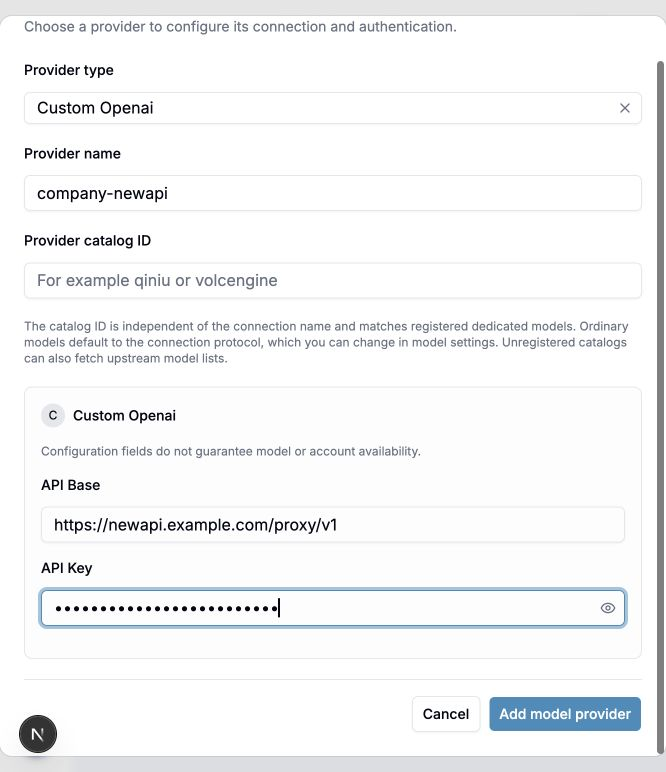
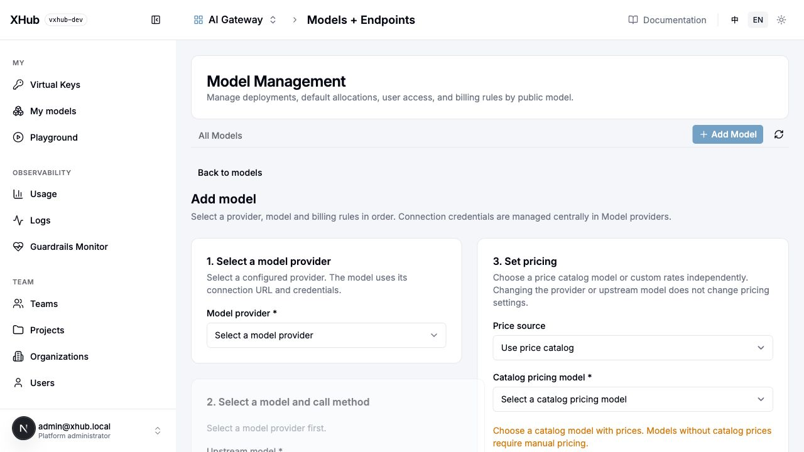

# Add model providers and implement new protocols

Check whether the supplier's API is already listed under XHub's upstream protocols. For an existing protocol, add the provider and deployment in the UI. Otherwise, implement it in `internal/provider/<supplier>/` and connect it to gateway execution. This guide covers NewAPI page operations and the source changes for a new protocol.

## 1. Choose the integration level

| Actual upstream behavior | Work required | Code changes |
| --- | --- | --- |
| NewAPI implements the OpenAI Chat request, response and SSE contract | Create a `custom_openai` credential and bind the deployment to registered `bypass_openai_chat` | No |
| Supported Responses, Messages, Gemini or registered media protocol | Choose its executor and verify each upstream operation | Usually no |
| Existing protocol with different authentication, paths or fixed models | Register a Transport; add fields/models where necessary | Yes |
| Suno-specific music creation, polling or callbacks | Public endpoint, executor, task lifecycle, measurement and UI | Yes, not just a directory |

Create NewAPI as a model provider in the XHub UI, then select that provider and an implemented upstream protocol for the deployment. The provider stores the address and authentication; the deployment stores the model and execution choice. Do not repeat addresses or keys in deployments. A NewAPI Chat route does not prove support for Responses, images, audio or music.

## 2. Connect NewAPI without writing code

Prerequisites: the actual API address, a NewAPI-issued key and a model that key can call. NewAPI keys and XHub virtual keys are not interchangeable.

1. Add `company-newapi` on the Model providers page and choose the provider type matching the actual Chat API. Enter its service address and NewAPI-issued key in the provider form, not in a deployment or startup configuration. Do not enter a console URL or a full operation URL.
2. Fetch models. Discovery does not create deployments. If discovery fails, preserve the error and manually enter an ID confirmed by the provider.
3. Add a deployment: public name `company-chat`, upstream model `gpt-4o-mini` (example only; use an account-authorized model), saved connection, and OpenAI Chat as the upstream protocol.
4. Its saved `model_info.transport` must be the registered `bypass_openai_chat`. Here `bypass` is XHub's upstream execution mode; it does not bypass XHub for the client. `endpoint_types: [chat]` exposes XHub's standard `/v1/chat/completions`. Declare `bypass:openai-chat` only when clients must use `/bypass/openai/v1/chat/completions` and preserve the native request.
5. Configure the actual contract price, save, reload and verify model, connection, protocol, price and enabled state. Relay prices are not automatically official prices.
6. Create an XHub virtual key authorized for `company-chat`, make a real gateway call, and inspect deployment, status, usage and the recorded price snapshot.

~~~bash
curl -i http://localhost:4000/v1/chat/completions \
  -H "Authorization: Bearer $XHUB_VIRTUAL_KEY" \
  -H "Content-Type: application/json" \
  -d '{"model":"company-chat","messages":[{"role":"user","content":"Reply with the word ready."}],"stream":false}'
~~~

Connection Test probes a saved dialogue deployment and may incur upstream charges. It bypasses the full virtual-key quota, routing and accounting chain, so it does not replace step 6. Verify `stream:true`, tools and application-specific parameters separately after a non-streaming call succeeds.

### What to enter on each page

#### A. Save the provider connection

Open **Model providers → Add provider**. For this Chat example, choose **Custom Openai**, enter **Provider name** `company-newapi`, and fill **API Base** and **API Key** on this page only. Leave **Provider catalog ID** blank for ordinary OpenAI Chat models; it is for registered dedicated model catalogs, not the connection name.

The screenshot uses a fictional address and a masked demonstration key. Save your own connection before creating a deployment. It does not show a tested NewAPI account.

#### B. Add the model deployment

Open **Models + Endpoints → Add Model**. Select the saved provider in step 1 to unlock step 2. Enter the upstream model ID and public model name, choose the upstream protocol, then select catalog pricing or enter your actual manual rates in step 3. Save and refresh to check the result.

This is the initial, unselected form: disabled model fields mean a provider has not been selected yet. Do not enter an address or key here, and do not edit model_list.

| Page | Enter | Verify after saving |
| --- | --- | --- |
| Model providers | Name, type, service address and authentication | `company-newapi` remains listed with the correct type |
| Model deployment | Public name `company-chat`, provider `company-newapi`, upstream model ID and protocol | Provider, model and protocol survive reload |
| Model pricing | Select an existing price or enter contract rates | Units are explicit; missing prices do not mean free |
| Virtual keys | Authorize public model `company-chat` | XHub calls succeed and logs show deployment and usage |

Fetching and importing a provider model list only adds model and price information to the AI model marketplace. Confirm the model, provider, protocol and pricing in the model form and add a deployment before gateway routing can use it. If discovery fails, manually enter an upstream ID confirmed by the provider.

### Addresses, discovery and credentials

- Base `https://newapi.example.com/proxy/v1` plus the registered `bypass_openai_chat` action `/v1/chat/completions` becomes `/proxy/v1/chat/completions`: XHub avoids duplicating `/v1` and preserves `/proxy`. Clients use XHub's address. See `internal/provider/openai/native.go` and `internal/dataplane/transport/bypass_url.go`.
- Compatible discovery merges the complete upstream list with local specialized models; it does not filter ordinary models through a local execution whitelist. Failures permit manual IDs. Discovery v1 fallback does not change inference addresses or protocols. See `internal/gateway/models`.
- The normal UI flow resolves address and authentication from the referenced model provider. Legacy deployments with inline addresses can prevent a provider address change from taking effect: runtime resolution fills empty addresses rather than overriding existing ones. This is a legacy-data diagnostic boundary, not a new configuration workflow. See `internal/llm/credentials/credential.go`.
- An unregistered `catalog_id` may remain relay metadata but creates no executor. Registered specialized catalogs validate models and TransportIDs. The backend reads the trusted catalog from the saved connection, not a forged request value.

## 3. Suno: obtain the actual contract first

Determine whether the target is an authorized official service, a NewAPI plugin or a third-party relay. Paths, authentication, statuses and results can differ. There is no `suno` transport or music endpoint in the current code. Collect redacted success and failure samples for:

1. Creation method/path/authentication, model/version, prompt, lyrics, style, instrumental flag, songs per request and charging point.
2. Task ID field and type, business failures inside HTTP 200, and absolute polling URLs.
3. Path versus query task IDs, pending/success/failure/cancellation states, audio URLs versus binary or multiple songs.
4. Required callbacks, signatures and replay protection, authenticated downloads, URL expiry, cancellation and listing.
5. Billing units: requests, songs, measured audio seconds or credits, failed-task charges and missing usage.

Reuse an existing protocol only for an operation that actually implements it. Music JSON is not `/v1/audio/speech`; video seconds are not automatically music usage. Numeric IDs, multiple results, OAuth/signatures and mandatory callbacks may require execution-layer changes. Uploading JSON cannot install an arbitrary protocol.

## 4. Development checklist and source map

### Add your own provider

**Example: reuse OpenAI Chat payloads with a new transport.** File: `internal/provider/acme/native.go`. Replace the example supplier and paths with your API contract. This is not a Suno implementation.

~~~go
package acme

import (
    contract "github.com/sunqirui1987/xhub/internal/provider/contract"
    measurement "github.com/sunqirui1987/xhub/internal/provider/measurement"
    registry "github.com/sunqirui1987/xhub/internal/provider/registry"
)

// init 登记 Acme 的 Chat 执行方式；无参数、无返回值。
// 由包加载调用，写入注册表；仅适用于 OpenAI Chat 请求与响应结构。
func init() {
    registry.RegisterTransport(contract.Transport{
        ID: "acme_chat", Label: "Acme Chat",
        Kind: contract.KindBypass,
        EndpointID: "bypass:openai-chat",
        Protocol: "openai-chat", Family: "chat",
        Providers: []string{"custom_openai"},
        ModelField: "model",
        Auth: contract.AuthConfig{Header: "Authorization", Prefix: "Bearer"},
        ResponseUsage: measurement.NativeUsage("openai-chat"),
        Actions: []contract.Action{{
            Name: "create", Method: "POST",
            PublicPath: "/bypass/acme/v1/chat/completions",
            UpstreamPath: "/v1/chat/completions",
        }},
    })
}
~~~

### Load the package

Add this import to `internal/provider/all/all.go`:

~~~go
import (
    _ "github.com/sunqirui1987/xhub/internal/provider/acme"
)
~~~

Rebuild and start the gateway → add the provider in the UI → create a deployment selecting **Acme Chat** → call with an XHub virtual key → check logs and usage. Enter the address and secret in the provider form.

### Different payloads: where to change code

| Difference | Source |
| --- | --- |
| Authentication header or fixed path | `Auth` and `Actions` above; signatures/OAuth need an authentication implementation |
| Request/response structure | `internal/dataplane/transport`; see `internal/dataplane/execution/official.go` |
| New client protocol | `internal/provider/capability/endpoints.go` + `internal/gateway`; renaming Protocol is insufficient |
| Specialized credential form | `internal/provider/registry/suppliers.go` + `internal/catalog/credential_providers.go` |
| Specialized model defaults | `RegisterModel` in `internal/provider/registry/models.go` |
| Usage and pricing | `internal/provider/measurement` + `internal/catalog` |
| Parameter editing and results | `frontend/src/components/chat`; maintain en/zh text |

### Asynchronous protocols: existing task example

Registration excerpt from `internal/provider/qiniu/seedance.go` (Ark video, not Suno):

~~~go
TaskID: "id",
Billing: providermeasurement.SeedanceBilling(),
Actions: []providercontract.Action{
    {Name: "create", Method: "POST",
        PublicPath: "/v3/contents/generations/tasks",
        UpstreamPath: "/v3/contents/generations/tasks"},
    {Name: "get", Method: "GET",
        PublicPath: "/v3/contents/generations/tasks/{id}",
        UpstreamPath: "/v3/contents/generations/tasks/{id}"},
},
~~~

Create → read string task ID → pin identity and deployment → poll → extract successful usage → settle once. Implement Suno IDs, states, song results and billing units from its actual contract, not video billing. Creation timeouts are not automatically replayed. Background polling, budget reservation and Suno callbacks require separate implementation.

## 5. Acceptance

~~~bash
go test ./internal/provider/... ./internal/llm/credentials ./internal/dataplane/transport
bash scripts/regression.sh 'TestProvider(Transport|Forms)Contract'
bash scripts/e2e.sh provider-forms.spec.ts docs-center.spec.ts
~~~

Use an isolated database and local upstream; see [testing](testing.md). Cover save/reload, invalid configuration, authentication, success/failure payloads and bilingual selection. Tasks additionally need pending states, multiple results, identity isolation and repeated-query settlement checks. Validate external suppliers separately.

## 6. Troubleshooting

| Symptom | Check and action |
| --- | --- |
| Discovered model fails inference | Key permissions, saved transport, actual path and error body; discovery is not inference |
| unregistered transport | all import, new build and restart; changing provider labels cannot bypass it |
| transport rejects provider | Providers allowlist versus connection type; use the actual protocol or extend with tests |
| Catalog rejects model | catalog_id, Official and TransportID; register actual model or use a compatible generic protocol |
| Connection update still calls old host | Remove stale deployment api_base and verify the destination |
| Creation works but polling fails | Original identity/deployment, ID field/type and path/query; do not send IDs to another service |
| Success has no price | Measured usage, unit and rates; retain unpriced status, never invent tokens or assume free |

Related: [credential forms](provider-credential-forms.md), [models/endpoints](model-endpoints.md), [provider source guide](../../../internal/provider/readme.md). New resources and OAuth APIs in the [provider redesign proposal](model-providers-design.md) are not current operational APIs.
