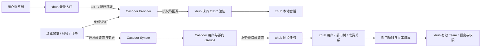

# Casdoor 企业登录与组织架构接入设计

日期：2026-10-11。状态：设计与源码核查完成；尚未修改产品代码、部署 Casdoor 或执行企业租户联调。

## 1. 设计结论

采用 Casdoor 统一企业微信、钉钉、飞书登录及通讯录同步。xhub 只对接 Casdoor 的标准 OIDC 和一个目录适配器，企业平台凭据保存在 Casdoor。xhub 保留自己的会话、预算、团队权限和审计体系。

“支持组织架构”明确包含：部门树、部门稳定标识、父子关系、人员、多部门直接成员关系、调岗、部门改名/移动，以及可靠的停用传播。登录成功或能列出人员，不等于组织架构接入完成。

第一版每个 xhub Organization 对应一个 Casdoor Organization，并且只有一个权威通讯录来源。可以部署多个公司分别选择不同平台；同一员工跨三平台自动合并不在第一版范围。多登录入口必须先完成明确的 Casdoor 账号关联，不能按姓名、手机号或邮箱自动合并。

## 2. 架构与职责

| 职责 | 实现位置 |
| --- | --- |
| 企业平台登录、平台访问令牌、通讯录权限 | Casdoor Provider / Syncer |
| 外部部门到 Groups 的转换、来源状态、离职与删除记录 | Casdoor，同步能力补齐后使用 |
| OIDC 校验、用户身份绑定、签发本地会话 | xhub 现有登录链 |
| 获取目录、维护部门树、多部门成员、同步状态 | xhub Casdoor 目录适配器与 IAM |
| 预算、Team 归属、管理员授权、调用权限、账单历史 | xhub |

登录沿用 `go-oidc` 与 `oauth2`，目录客户端优先使用官方 `casdoor-go-sdk` 的独立 Client；需要的分页或快照接口由一个受控 HTTP 适配器补充。禁止使用 SDK 全局配置承载多个组织。锁定具体依赖版本；不以 SDK 接入替代 OIDC 签名与协议校验。

## 3. 源码核查与必须补齐的能力

核查对象为 Casdoor master 快照 `fd7295a616acc3c67702cc33fea82a0b0b2175aa`。下表说明这个快照的实现情况，不代表所有发行版。实际部署需选择通过验收的固定版本和镜像摘要，并记录补丁。

| 平台 | 登录 Provider | 人员同步 | 部门及成员同步 | 组织树结论 |
| --- | --- | --- | --- | --- |
| 企业微信 | 已有 | 已有 | 已有 Groups、ParentId 和成员接口 | 已有基础能力，受应用可见范围和通讯录权限限制 |
| 钉钉 | 已有 | 已有 | 已有 Groups 与成员接口 | 部门对象读取了 parent_id，但转换 OriginalGroup 时没有写入 ParentId，必须补齐 |
| 飞书 / Lark | 已有 | 已有 | GetOriginalGroups、GetOriginalUserGroups 仍返回空数组，用户 Groups 为空 | 必须补齐部门、父级和直接成员同步；中国飞书使用 open.feishu.cn |

Casdoor 的 Group 模型已有 `Owner`、`Name`、`ParentId`、`IsTopGroup`，可以承载部门树，无须另建身份平台。钉钉和飞书的缺口应修在 Casdoor 中，优先贡献上游；交付前可以维护小规模固定版本补丁。xhub 不再分别集成三套企业 SDK。

另外两项跨平台缺口会影响生命周期管理，需要分阶段处理：

1. 当前通用 `syncUsers()`、`syncGroups()` 主要执行新增与更新，没有完整的来源删除对账。原平台不再返回某个人，Casdoor 中可能仍保留旧账号；仅轮询 Casdoor 用户列表不能可靠处理离职。需要来源明确的停用/删除记录，或在确认完整且可见范围未变化的来源快照后执行对账。
2. 部分同步逻辑遇到部门读取/更新失败会记录错误后继续，且人员、组与分页读取不是同一个原子快照。不能把“API 请求成功”当作“整个企业通讯录完整同步成功”。必须提供可判定的完成版本与错误状态。

Casdoor 的 SCIM Syncer 是从 SCIM 来源导入数据的实现，不能据此认定 Casdoor 能自动向 xhub 推送 SCIM。第一版采用 Casdoor 目录读取，继续保留 xhub 原有 SCIM 接入能力。

## 4. 登录与身份绑定

复用现有授权码、PKCE S256、浏览器绑定 state、nonce、单次登录事务以及 issuer/audience/签名/过期校验。Casdoor 使用专属 xhub Application 和预先登记的 HTTPS 回调地址，限制到目标 Organization；不启用跨组织共享 Application。现有回调地址由 xhub 页面生成，以真实公开部署地址为准。

目录映射采用：

| 本地字段 | 来源 | 约束 |
| --- | --- | --- |
| directory_connections.organization_id | 管理员指定的 xhub Organization | 一组织一个权威目录 |
| directory_users.external_id | Casdoor User.Id | 在该连接内非空且唯一 |
| enterprise_oidc.identity_claim | sub | 必须与同一用户 User.Id 一致 |
| directory_groups.external_id | Casdoor Group.Name | 在该连接内稳定且唯一，不使用显示名 |
| directory_groups.parent_id | 规范化的 Group.ParentId | 本地父部门引用，根部门为空 |
| directory_group_members | Casdoor User.Groups | 保留直接成员关系，按 owner/name 解析 |

核查快照中的 token sub 和 userinfo sub 来自 User.Id；该 Id 可能是平台 userid，不能假定它总是全局 UUID。身份必须以连接、issuer、目标 owner 和稳定 Id 的组合限定。校验 token 的 owner 与配置组织一致；若选用的 token 格式没有 owner，则需要可信的服务端组织校验或增加受签名保护的组织声明，不能只接受一个裸 sub。

登录仅放行已成功同步且有效的本地普通用户，不在回调中盲目创建用户。未同步账号显示可操作的失败提示，管理员可触发同步。邮箱只作联系资料，不用于跨账号绑定。保留现有本地管理员应急登录。

现有登录默认只请求 openid。实施时以锁定版本验证 scope、PKCE、nonce、discovery、JWKS、反向代理后的 issuer 与 audience；需要 profile/email 时显式增加 scope，身份绑定仍依赖稳定 Id。SSO 不自动包含统一注销；第一版退出 xhub 即撤销本地会话，Casdoor 全局注销另行验收。

三平台 Provider 登录与 Syncer 的平台标识类型必须对齐，例如 userid 与 open_id 不能直接互换。验收必须证明扫码登录命中已同步的同一 Casdoor 用户，而不是创建第二个账号。

## 5. 部门树与现有权限模型

公司对应 xhub Organization；部门作为独立目录树；员工可以属于多个部门。部门不是自动生成的预算组织或 Team。管理员将需要预算归属的部门映射到现有 Team，继续复用现有人工归属与自动分配逻辑。

当前 `team_members.user_id UNIQUE` 表示一个员工只有一个有效 Team。保持现有规则：人工归属优先；自动分配保留仍有效的当前归属；否则按映射优先级及稳定映射 Id 选择；最后使用配置的默认 Team。部门父子关系不自动继承授权，父部门映射是否包含子部门必须明确配置后才能扩展。

外部管理员、部门负责人或 Casdoor 角色不会自动授予 xhub 管理员权限。部门改名不改变绑定；移动部门更新父级；删除部门归档目录记录并重新计算受影响员工归属，不删除历史账单或调用审计。

Casdoor 的 Group.Name 对企业微信和钉钉可能都是数字部门 Id，同一 Casdoor Organization 混合多个通讯录会碰撞。第一版单一权威来源避免这一问题；未来多源需在 Casdoor 侧加入来源/租户命名空间并迁移所有成员和父级引用。

## 6. 目录同步协议与一致性

第一版提供后台周期同步和管理员“立即同步”，周期建议从 5 分钟开始，增加随机偏移、超时和限流退避。平台事件或 Casdoor webhook 用来提示尽快同步；它们不替代周期对账。

为了尽快交付用户要求的登录和组织架构读取，第一阶段使用现有 Casdoor 用户/组 API：限定 owner，分页读取全部用户和部门到 staging，验证父级与直接成员引用，在本地事务内应用。使用 /api/get-groups 的分页平面数据，在本地构树，避免依赖非分页 withTree 的规模限制。发现上游变动导致引用缺失时重试或保留最后有效结果，不据缺失自动删除或停用；仅应用明确的禁用状态和人工停用。分页 API 不提供严格的一致时点，界面应如实区分“读取成功”和“来源完整性未证明”。这可以交付部门树、多部门归属和 Team 映射，但不承诺完整离职管理。

第二阶段如需可靠自动对账、完整删除/离职传播及严格新鲜度约束，再增加下述快照契约。它不是首期展示组织架构的前置条件。

### Casdoor 侧补充的最小契约（设计接口，当前尚不存在）

每个权威来源维护 `source_id`、`source_tenant_id`、`scope_revision`、`generation`、`started_at`、`completed_at`、`status`、实体数量及校验摘要。必须先完整读取用户、部门、直接成员和停用/删除变化，校验通过，再发布不可变 generation；部分失败的运行不得成为完成版本。

提供受认证保护、限定 Organization 的目录快照读取接口，返回非敏感用户字段、部门和直接成员，使用固定 generation 的游标分页。对账得到的停用/删除记录必须标注实体类型、稳定 Id、来源和 generation。可以复用 Casdoor 数据结构，但快照不能是每一页即时拼接的活动表。

来源可见范围就是同步边界，不宣称超出应用授权范围的“全公司通讯录”。范围或授权变更后递增 scope_revision，并暂停基于缺失的停用判定；恢复后建立新的完整基线。明确离职/禁用事件仍可及时应用。单纯等待两次快照或设置数量阈值不能证明用户已离职。

Casdoor 来源 Syncer 设置为读取来源，禁止反向写入企业通讯录。对来源失败、离职信息不可得和权限不足明确返回状态；禁止成功返回空列表掩盖未实现能力。

### xhub 应用过程

1. 获取租约并记录连接配置 revision，读取最新已完成 generation；记录两段时间：平台到 Casdoor 的完成时间、Casdoor 到 xhub 的应用时间。
2. 全部分页进入 staging，验证 owner、非空/重复 Id、计数摘要、父级、成员引用和停用记录。父级因可见范围缺失时保留“范围外父级”诊断并显示为可见根；意外缺失、自引用、成环与跨 owner 引用拒绝本轮应用。
3. 使用 User.Groups 的直接部门关系，不把 Group.Users 中可能包含的继承成员当作直接成员。规范化裸 ParentId、owner/name 与 Casdoor 顶层指向 Organization 的约定。
4. 再次校验 lease、revision 和 generation，在数据库事务中应用用户、部门、成员、有效 Team 与同步统计；失败整体回滚。旧 generation、旧配置或过期任务不能覆盖新版本。
5. 应用明确来源的停用/删除记录，递增 session_version，立即拒绝新的本地登录及该用户 API Key 的后续调用；保留财务和审计历史。导入的 active 状态不能解除本地管理员的安全封禁。
6. 更新已应用 generation、计数和审计。网络错误、429、权限不足、上游运行未完成时保留最后有效目录，不依据缺失批量停用。

正常变化可见延迟约为“来源同步周期 + xhub 同步周期 + 执行时间”。上游不可用时不能承诺这个上界。建议目录新鲜度阈值初始为 15 分钟，超过后禁止新的企业登录；既有会话和 API Key 的继续使用或到期拒绝按组织策略明确设置，并用请求鉴权检查保证生效。界面显示延迟状态，不能以最近一次成功 HTTP 请求重置新鲜度。

在快照契约未完成前，普通 API 读取可以按实际覆盖情况验收三平台部门树和成员查询；删除对账、完整离职管理与来源快照一致性必须单独列为未覆盖，不能把读取成功当作生命周期验收通过。

## 7. xhub 数据与代码改造

已有基础是 `internal/iam/enterprise_oidc.go`、`internal/gateway/enterprise_oidc.go` 以及 directory 系列表和服务。新增目录适配器建议放在 `internal/enterprise/casdoor/`，协议隔离于 IAM。具体文件名以实施时模块约定为准。

| 改造 | 要点 |
| --- | --- |
| directory_connections | 增加 source_type（scim/casdoor）；保留一组织一权威目录约束 |
| directory_casdoor_configs | 保存 endpoint、owner、Application、加密服务凭据、同步周期、新鲜度策略、revision |
| directory_groups | 增加 parent_id、来源类型、归档状态、最后已见 generation；父级必须同连接 |
| 同步运行与 staging 表 | run 状态、租约 fencing、来源版本、数量、分页完整性、错误分类；不存源密码与令牌 |
| 本地用户状态 | 区分来源停用与本地封禁，分别记录原因；有效状态同时满足两者 |
| IAM 目录服务 | 抽出与来源无关的内部应用服务；SCIM HTTP 和 Casdoor worker 共同调用 |
| 网关与管理页 | 配置、测试、同步、状态、部门树、成员与 Team 映射 |

目前很多目录方法显式要求 `scim_configured=true`，不能让 Casdoor worker 绕过权限或伪造启用 SCIM。应将来源无关的持久化与归属逻辑移到内部服务，SCIM 的令牌鉴权继续留在 SCIM 边界。SSO 开关、同步暂停和组织访问停用分别建模；暂停同步不等同关闭 SSO，超过新鲜度限制另按策略处理。

现有 users.email 必填且唯一，目录写入要求邮箱，但平台可能不提供邮箱。设计选择允许企业托管账号缺少联系邮箱，并以目录身份作为主标识；本地密码账号仍要求有效邮箱。需同步迁移邮箱唯一索引/验证状态及所有相关页面、密码重置、通知和查询逻辑。已有本地同邮箱账号产生显式冲突并进入管理员迁移流程；不自动合并、不伪造已验证邮箱。

## 8. 管理体验与凭据边界

企业接入按组织展示“单点登录”和“组织架构”两个独立配置区：

- 单点登录：Casdoor issuer、Client ID、加密 Client Secret、只读回调地址、测试和启停。
- 组织架构：Casdoor 服务地址、Organization、目录服务凭据、同步周期、测试连接、立即同步、暂停同步。
- 状态：平台来源同步结果、xhub 应用结果、最近完整版本、人员/部门数、失败原因及权限范围。
- 组织架构：可展开部门树、搜索人员、查看多部门归属；另行配置部门到 Team 的映射及人工归属。

不要求管理员在 xhub 填写三平台的 AppSecret。目录服务凭据与浏览器登录凭据分开，服务接口只读且限定目标 Organization；Casdoor 应用凭据可能拥有较广的管理权限，实施时必须实际验证权限拒绝，若版本不能限制则为快照接口增加服务身份与只读范围。秘密不回显，日志只输出必要字段，目录客户端丢弃密码、盐、令牌等无关字段。

服务 endpoint 由授权管理员配置，限制协议、重定向与目标主机；需要私网部署时使用明确允许的 Casdoor 地址，防止目录探针访问任意内网服务。外部平台通讯录权限、应用可见范围、扫码登录域名和回调域名均需在平台管理端配置。

所有新增界面、错误和动态文档接入现有 zh-CN/en i18n，示例请求与提示词使用英文，保留用户原始名称及输入。

## 9. 实施顺序与验收

1. 固定 Casdoor 版本，建立隔离环境，首期补齐钉钉 ParentId 和飞书部门/直接成员。逐一验证三平台登录账号与同步账号的一致性。
2. 实现 xhub 目录服务分层、数据迁移、Casdoor Client、staging 应用与状态检查；复用现有 OIDC 身份绑定。首期使用普通分页 API，明确缺失记录不自动停用。
3. 增加配置区、部门树、成员查询与团队映射，完成中英文界面和错误提示。
4. 运行单元、真实后台 regression 和自动化浏览器 E2E；再用各平台隔离测试企业验收授权范围与真实离职事件。
5. 按生命周期需求增加来源完整版本、停用/删除对账和不可变快照契约，完成第二阶段的自动离职与一致性验收。下表覆盖两阶段，快照/对账相关测试随第二阶段实现，不把计划测试计为首期已通过。

| 测试层 | 必须覆盖 |
| --- | --- |
| Casdoor 补丁单元/协议测试 | 钉钉根与父级、飞书分页/成员/父级、重复与缺失标识、授权范围变化、明确离职、部分失败不发布完整版本 |
| xhub 单元/组件测试 | Id 与 parent 规范化、成环/跨组织/空值、映射优先级、多部门单有效 Team、邮箱缺失/冲突、429/超时、状态策略、zh-CN/en 文案与原始输入 |
| 后台 regression | 隔离 PostgreSQL 与真实路由；加密配置、只读鉴权、完整分页和回滚、revision/租约竞态、SCIM 兼容、owner/sub 绑定、停用会话/API Key、管理员封禁保持、财务历史保留与数据清理 |
| 浏览器 E2E | 真实 Casdoor 测试实例、真实 xhub 后台和隔离数据库；管理员配置并同步、部门树/多部门成员、映射后真实额度归属、浏览器 OIDC 往返登录、调岗/改名/移动、停用后页面与 API 拒绝、同步失败保留数据、新鲜度策略、中英文切换及凭据不回显 |
| 真实平台验收 | 企业微信/钉钉/飞书各一测试租户；登录与通讯录 Id 对齐、可见范围、真实权限不足、人员离职/冻结、部门变化和限流 |

离线外部协议夹具用于明确的来源正常/失败/降级路径；浏览器关键路径仍要走真实 Casdoor 和 xhub，不只验证 mock 页面。每次测试使用独立数据并清理，不读取未声明的真实企业凭据。新函数及测试按项目要求提供完整中文注释。

## 10. 本次交付与来源

本次新增此设计文档，未修改产品代码、接口、配置或数据结构，未运行单元、后台 regression 或 E2E：执行数量为 0，不作通过/失败判定，无新增测试报告。上文是待实施的验收要求，不是已验证结果。已有 enterprise-directory-validation.md 的历史测试结果不作为本设计的互操作证明。

本次实际进行了 `git status --short`、`rg` 与 `sed` 的本地结构/源码核查，以及 GitHub 公共仓库元数据、目录和源码读取。外部未验证边界：Casdoor 实际部署、固定发行版兼容性、服务凭据权限、三平台真实扫码/免登、通讯录授权范围、源删除/离职事件、生产新鲜度与吞吐。

可核查的开源来源：

- [Casdoor，Apache-2.0](https://github.com/casdoor/casdoor) 与 [官方 Go SDK](https://github.com/casdoor/casdoor-go-sdk)。
- [企业微信同步实现](https://github.com/casdoor/casdoor/blob/fd7295a616acc3c67702cc33fea82a0b0b2175aa/object/syncer_wecom.go)。
- [钉钉同步实现](https://github.com/casdoor/casdoor/blob/fd7295a616acc3c67702cc33fea82a0b0b2175aa/object/syncer_dingtalk.go)，核查部门到 OriginalGroup 的转换。
- [飞书/Lark 同步实现](https://github.com/casdoor/casdoor/blob/fd7295a616acc3c67702cc33fea82a0b0b2175aa/object/syncer_lark.go)，核查 GetOriginalGroups / GetOriginalUserGroups 的 TODO。
- [Group 模型](https://github.com/casdoor/casdoor/blob/fd7295a616acc3c67702cc33fea82a0b0b2175aa/object/group.go) 与 [Group API](https://github.com/casdoor/casdoor/blob/fd7295a616acc3c67702cc33fea82a0b0b2175aa/controllers/group.go)。
- [通用组同步](https://github.com/casdoor/casdoor/blob/fd7295a616acc3c67702cc33fea82a0b0b2175aa/object/syncer_group.go) 与 [通用人员同步](https://github.com/casdoor/casdoor/blob/fd7295a616acc3c67702cc33fea82a0b0b2175aa/object/syncer_sync.go)。
- [SCIM Syncer 的导入方向](https://github.com/casdoor/casdoor/blob/fd7295a616acc3c67702cc33fea82a0b0b2175aa/object/syncer_scim.go)。
- [OIDC token 身份与组织](https://github.com/casdoor/casdoor/blob/fd7295a616acc3c67702cc33fea82a0b0b2175aa/object/token_jwt.go)。
