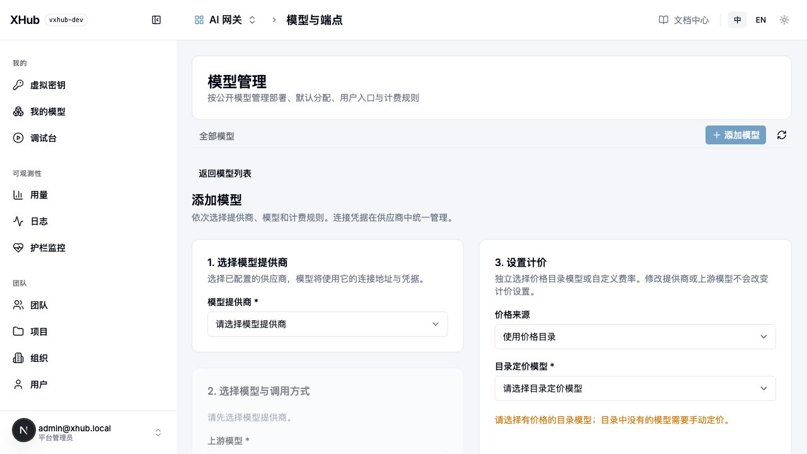

# 模型与端点

部署选择已保存供应商、上游型号、对外名称、执行协议和价格。先保存供应商，再创建部署。

## 页面字段对应代码

| 字段 | 用途 |
| --- | --- |
| model_name | 客户请求、权限与选路使用的模型名 |
| litellm_params.model | 上游实际型号 |
| litellm_credential_name | 保存的供应商连接 |
| model_info.transport | 必须已注册的执行器 |
| endpoint_types | 标准入口按能力生成；Bypass/Fal 显式启用 |

价格不决定协议。未知或缺失 transport 拒绝保存。/public/endpoints 是注册目录；/model/available 是当前身份真正可调用的模型端点。

## 发现、续接与回退

- 模型发现只在 404 后尝试另一个 /models 或 /v1/models 路径，两次共用 20 秒；其他错误和成功空列表不回退，不修改推理地址。
- 标准 Responses 用 previous_response_id 续接，临时历史保留一小时；instructions 不继承。无 Redis 时不跨进程，原部署不可用返回 409 continuation_unavailable。不提供长期原厂响应存储。
- 回退重新检查目标权限和预算；已输出的流、固定部署续接和结果不确定的异步创建不跨模型重放。

## 源码与验证

[部署校验](../../../internal/provider/deployment/validate.go) · [新增 provider 代码](provider-catalog.md) · [回退配置](routing.md)

~~~bash
go test ./internal/provider/... ./internal/dataplane/... -count=1
~~~
