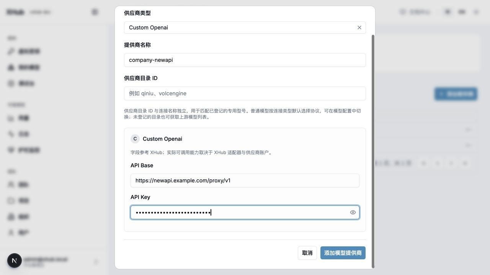

# 添加模型供应商与开发新协议

接入一个新供应商，先看它的接口是否已经在 XHub 的“上游接口协议”列表中。已有协议就在页面添加供应商和模型部署；没有对应协议，就在 `internal/provider/<supplier>/` 增加实现，并接入网关执行链。下面分别说明 NewAPI 的页面操作，以及新协议的代码修改位置。

## 1. 先选接入方式

| 上游实际行为 | 接入工作 | 是否改代码 |
| --- | --- | --- |
| NewAPI 实际提供 OpenAI Chat 请求、响应和 SSE | 创建 `custom_openai` 连接，部署绑定已登记的 `bypass_openai_chat` | 不需要 |
| 已支持的 Responses、Messages、Gemini 或媒体协议 | 选择对应执行器，逐个验证上游实际能力 | 通常不需要 |
| 同一协议，但认证头、固定路径或专用型号不同 | 注册 Transport，必要时补认证字段和目录型号 | 需要 |
| Suno 自有音乐生成、查询或回调协议 | 补公开端点、执行器、任务生命周期、计量和界面 | 需要，不止加目录 |

在 XHub 页面中把 NewAPI 创建为一个模型供应商，再为模型部署选择这个供应商和已实现的上游协议。供应商保存地址与认证，部署保存模型与执行方式；不在模型中重复填写地址和密钥。NewAPI 能转发 Chat，不代表 XHub 可以用它调用 Responses、图片、音频或音乐任务。

## 2. NewAPI：不写代码的接入步骤

前置：有服务地址、NewAPI 签发的 API Key，以及该 Key 可调用的模型。XHub 虚拟密钥与 NewAPI Key 不能互换。

1. 在“模型供应商”页面添加供应商，命名为 `company-newapi`，选择与实际 Chat 接口对应的供应商类型。在供应商表单中填写服务地址和 NewAPI 签发的密钥；不是在模型部署中填写，也不用写进启动配置。服务地址不是控制台 URL 或完整操作 URL。
2. 获取模型目录。读取列表不等于创建部署。目录不可用时保留错误，按供应商确认的 ID 手动输入；不能凭空生成可调用型号。
3. 添加模型部署：对外名 `company-chat`，上游模型 `gpt-4o-mini`（仅示例，以账户实际型号为准），选择保存的连接；“上游接口协议”选 OpenAI Chat。
4. 保存后的 `model_info.transport` 必须是已注册的 `bypass_openai_chat`。这里的 `bypass` 是 XHub 的上游执行方式，不是让客户绕过 XHub。`endpoint_types: [chat]` 表示客户通过 XHub 的标准 `/v1/chat/completions` 入口访问；只有需要客户直接使用 `/bypass/openai/v1/chat/completions` 并保留原始请求时，才声明 `bypass:openai-chat`。
5. 配置实际价格。中转价不默认等于官方价；人工费率按合同填写。保存并刷新，核对型号、连接、协议、价格和启用状态。
6. 创建有权使用 `company-chat` 的 XHub 虚拟密钥，发真实网关请求，再核对日志中的部署、状态、用量和当次价格快照。

~~~bash
curl -i http://localhost:4000/v1/chat/completions \
  -H "Authorization: Bearer $XHUB_VIRTUAL_KEY" \
  -H "Content-Type: application/json" \
  -d '{"model":"company-chat","messages":[{"role":"user","content":"Reply with the word ready."}],"stream":false}'
~~~

连接测试只探测保存的对话部署，可能产生供应商费用，不经过完整虚拟密钥额度、路由和用量记账链，不能替代第 6 步。非流式成功后再验证 `stream:true`、工具调用和业务所需参数；一次文本成功不证明全部能力。

### 页面中哪些内容填在哪里

#### A. 先保存模型供应商连接

打开“模型供应商 → 添加提供商”。本例接入 Chat，供应商类型选择 **Custom Openai**，提供商名称填 `company-newapi`，在这里填写 **API Base** 和 **API Key**。“供应商目录 ID”对普通 OpenAI Chat 模型留空；它用于已登记的专用模型目录，不是连接名称。

截图使用虚构地址和已遮挡的演示密钥，不代表已验证 NewAPI 账户。请先保存自己的连接，再创建模型部署。

#### B. 再添加模型部署

打开“模型管理 → 添加模型”。第 1 步选择刚保存的供应商后，第 2 步才可填写上游模型 ID、对外模型名称并选择上游协议；第 3 步选择价格目录或填写实际合同费率。保存后刷新核对。

截图是尚未选择供应商的初始表单。模型区域置灰表示需要先选供应商，不是要求在这里再填地址、密钥或编辑 model_list。

| 页面 | 填写内容 | 保存后检查 |
| --- | --- | --- |
| 模型供应商 | 供应商名称、类型、服务地址和认证 | 列表中能找到 `company-newapi`，编辑后仍保留正确类型 |
| 模型部署 | 公开模型名 `company-chat`、供应商 `company-newapi`、上游模型 ID、上游协议 | 刷新后供应商、模型和协议没有改变 |
| 模型定价 | 选择已有价格或填写实际合同费率 | 价格单位明确；没有价格不能当成免费 |
| 虚拟密钥 | 授权公开模型名 `company-chat` | 通过 XHub 请求成功，日志显示实际部署和用量 |

获取并导入供应商模型列表只会向 AI 大模型广场加入模型与价格信息；还要在模型表单确认型号、供应商、协议和价格并添加部署，才能参与网关选路。列表获取失败时可以手动填写供应商确认可用的上游 ID。

### 地址、目录与凭据规则

- 模型供应商表单的服务地址 `https://newapi.example.com/proxy/v1` 与已注册 `bypass_openai_chat` 动作 `/v1/chat/completions` 拼为 `/proxy/v1/chat/completions`：代码避免重复 `/v1`，保留 `/proxy` 前缀。客户调用 XHub 地址，不调用 NewAPI 地址。代码：`internal/provider/openai/native.go`、`internal/dataplane/transport/bypass_url.go`。
- 兼容目录合并供应商完整列表与本地专用型号，不按本地执行白名单截断普通型号。发现失败可手动输入；目录 v1 回退不修改推理根地址或协议。实际发现实现：`internal/gateway/models`。
- 正常页面流程通过模型供应商引用取出地址和认证。部署级地址优先；运行时供应商地址只补空值。代码：`internal/llm/credentials/credential.go`。
- 未注册 `catalog_id` 可以保留为中转元数据，不会产生执行器；已注册专用目录检查型号和 TransportID。后台从保存连接读取可信目录，不信任请求伪造值。

## 3. Suno：先确认真实协议

“接 Suno”可能指官方授权服务、NewAPI 插件或第三方中转，三者路径、认证、状态和结果不保证一致。当前没有 `suno` transport 或音乐端点，不要照抄网络路径当成已实现接口。接入前收集以下契约及脱敏成功/失败样本：

1. 创建：方法、路径、认证、模型/版本、提示词、歌词、风格、纯音乐开关，一个请求生成几首，何时收费。
2. 返回：任务 ID 字段及类型、HTTP 200 是否可能包含业务失败、是否返回绝对查询 URL。
3. 查询：ID 在路径还是 query，处理中/成功/失败/取消状态，结果是音频 URL、二进制还是多首歌曲。
4. 生命周期：是否强制回调、验签与防重放、下载认证、URL 有效期、取消及列表操作。
5. 用量：按请求、歌曲、实测音频秒数还是 credits；失败是否扣费，缺失用量如何处理。

仅当某操作确实实现已有兼容协议才复用那个操作。音乐 JSON 不能冒充 `/v1/audio/speech`，视频 seconds 不能直接当音乐账单。数值任务 ID、多结果、OAuth/签名认证、强制回调可能超出当前 Transport 字段，需扩展执行层。当前没有上传 JSON 自动安装任意协议的功能。

## 4. 开发接入：文件修改顺序

### 自己添加一个 provider

**示例范围：复用 OpenAI Chat 结构，新增执行器。** 文件：`internal/provider/acme/native.go`。`acme` 是示例供应商；路径须按实际接口修改。此例不是 Suno 实现。

~~~go
package acme

import (
    contract "github.com/sunqirui1987/xhub/internal/provider/contract"
    measurement "github.com/sunqirui1987/xhub/internal/provider/measurement"
    registry "github.com/sunqirui1987/xhub/internal/provider/registry"
)

// init 登记 Acme 的 Chat 执行方式；无参数、无返回值。
// 由包加载调用，写入注册表；仅适用于 OpenAI Chat 请求与响应结构。
func init() {
    registry.RegisterTransport(contract.Transport{
        ID: "acme_chat", Label: "Acme Chat",
        Kind: contract.KindBypass,
        EndpointID: "bypass:openai-chat",
        Protocol: "openai-chat", Family: "chat",
        Providers: []string{"custom_openai"},
        ModelField: "model",
        Auth: contract.AuthConfig{Header: "Authorization", Prefix: "Bearer"},
        ResponseUsage: measurement.NativeUsage("openai-chat"),
        Actions: []contract.Action{{
            Name: "create", Method: "POST",
            PublicPath: "/bypass/acme/v1/chat/completions",
            UpstreamPath: "/v1/chat/completions",
        }},
    })
}
~~~

### 加载新包

在 `internal/provider/all/all.go` 的 import 中加入：

~~~go
import (
    _ "github.com/sunqirui1987/xhub/internal/provider/acme"
)
~~~

重建并启动网关 → 页面添加模型供应商 → 添加部署并选择 **Acme Chat** → 用 XHub 虚拟密钥调用 → 核对日志和用量。地址、密钥仍在供应商表单填写。

### 请求结构不同，改哪里？

| 差异 | 修改位置 |
| --- | --- |
| 认证头、固定路径 | 上例 `Auth`、`Actions`；签名/OAuth 需认证实现 |
| 请求/响应结构 | `internal/dataplane/transport`；参考 `internal/dataplane/execution/official.go` |
| 新客户协议入口 | `internal/provider/capability/endpoints.go` + `internal/gateway`；不能只改 Protocol 名称 |
| 专用认证表单 | `internal/provider/registry/suppliers.go` + `internal/catalog/credential_providers.go` |
| 专用型号默认值 | `internal/provider/registry/models.go` 的 `RegisterModel` |
| 用量与价格 | `internal/provider/measurement` + `internal/catalog` |
| 参数编辑与结果展示 | `frontend/src/components/chat`，同步 en/zh 文案 |

### 异步协议：参考现有任务实现

`internal/provider/qiniu/seedance.go` 的实际注册片段（Ark 视频，不是 Suno）：

~~~go
TaskID: "id",
Billing: providermeasurement.SeedanceBilling(),
Actions: []providercontract.Action{
    {Name: "create", Method: "POST",
        PublicPath: "/v3/contents/generations/tasks",
        UpstreamPath: "/v3/contents/generations/tasks"},
    {Name: "get", Method: "GET",
        PublicPath: "/v3/contents/generations/tasks/{id}",
        UpstreamPath: "/v3/contents/generations/tasks/{id}"},
},
~~~

创建 → 提取字符串任务 ID → 固定身份和原部署 → 查询 → 成功用量 → 去重结算。Suno 按实际契约实现 ID、状态、歌曲结果和计价单位，不能复用视频账单。创建超时不自动重发；后台补查、预算预占、Suno 回调目前需另行实现。

## 5. 验收

~~~bash
go test ./internal/provider/... ./internal/llm/credentials ./internal/dataplane/transport
bash scripts/regression.sh 'TestProvider(Transport|Forms)Contract'
bash scripts/e2e.sh scenarios/legacy/provider-forms scenarios/legacy/docs-center
~~~

使用隔离数据库和本地上游，准备方式见[测试指南](testing.md)。覆盖保存/刷新、非法配置、认证、正常/失败响应、双语选择；异步任务另测处理中、多结果、身份隔离和重复查询不重复结算。外部供应商实测需单独验收。

## 6. 故障定位

| 现象 | 检查与处理 |
| --- | --- |
| 目录有型号但调用失败 | Key 权限、保存的 transport、实际路径与错误正文；目录成功不等于推理成功 |
| unregistered transport | 是否导入 all、是否使用新构建并重启；改 provider 标签不能绕过 |
| transport 不支持 provider | Providers 白名单与连接类型；使用真实协议连接或经测试扩展 |
| 专用目录不支持型号 | catalog_id、Official、TransportID；登记真实型号或选择通用协议 |
| 供应商地址更新未影响部署 | 部署设置了 api_base 覆盖；清理覆盖并核对实际目标 |
| 创建成功但查询失败 | 原身份/部署、ID 字段类型、路径/query；不要把 ID 发给另一供应商 |
| 成功但无价格 | 实测 usage、单位/费率；保留待核价，不能编造 token 或当成免费 |

相关：[认证表单](provider-credential-forms.md) · [模型与端点](model-endpoints.md) · [provider 代码导航](../../../internal/provider/readme_cn.md)。[供应商重构提案](model-providers-design.md)中的新资源与 OAuth API 不是当前可调用接口。
